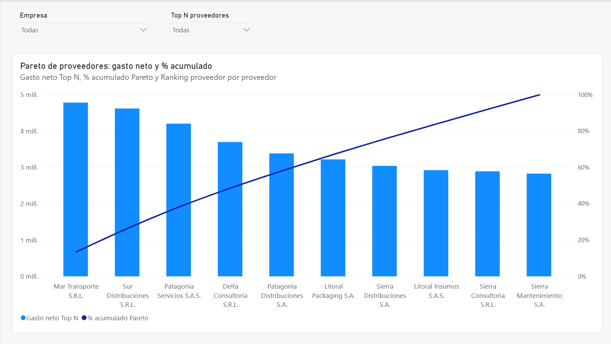
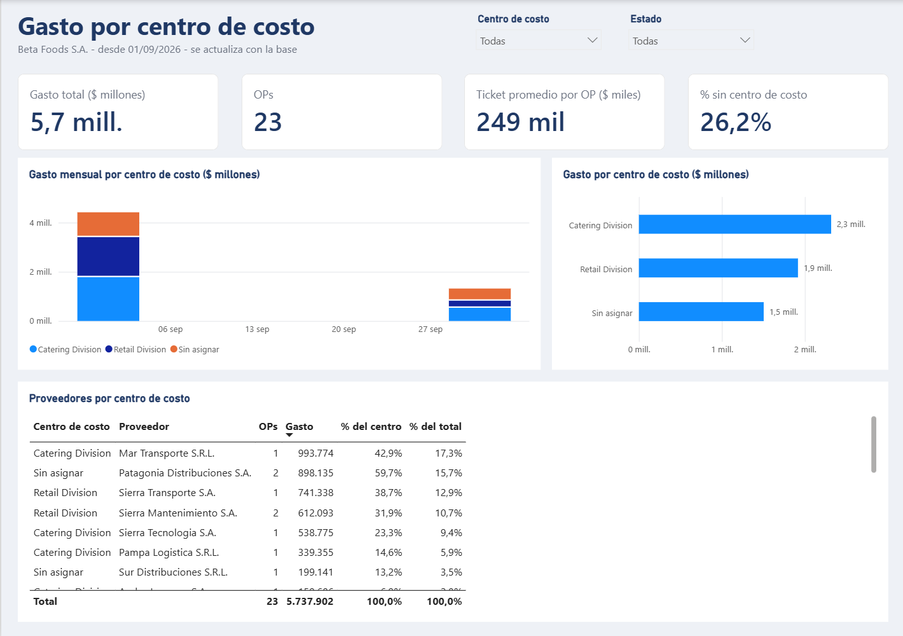

# Power BI

`PaymentsDashboard/PaymentsDashboard.pbip` is a Power BI project in the PBIP format (TMDL semantic model + PBIR report), so every change is a readable text diff.

## Pages

**Tablero (dashboard)**: KPI cards, monthly spend with a 3-month moving average, pending payables by company and due-date status, Top 10 supplier Pareto and a table of overdue payment orders.

**Proveedores**: supplier Pareto (net spend and cumulative %) with company and Top N slicers.

**Centros de costo**: spend by cost centre, monthly and by supplier, including the share not yet assigned.

## Open it

1. Load the database from [payments-data-platform](https://github.com/lautarobermudez/payments-data-platform) into PostgreSQL (`localhost:5432`, database `payments`).
2. Open `PaymentsDashboard.pbip` in Power BI Desktop and press *Refresh*.
3. If you get a certificate error, untick *Encrypt connections* in the data source permissions (a local database uses a self-signed certificate).
