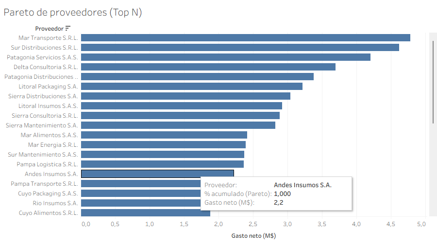

# Tableau

`payments_dashboard.twbx` is a packaged workbook (CSV and extract included, no database needed). It has two parameters (cut-off date and Top N), calculated fields with LOD expressions and table calculations, eleven worksheets and one dashboard.

Pareto sheet, controlled by the Top N parameter:

